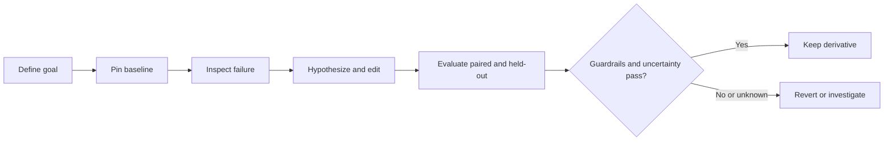

# Weight Space Workbench

**A reproducible `edit → evaluate → compare → keep or revert` workflow for neural-network weights.**

[](https://github.com/dshivendra/weight-space-workbench/actions/workflows/quality.yml)
[](LICENSE)
[](https://github.com/dshivendra/weight-space-workbench/stargazers)
[](https://github.com/dshivendra/weight-space-workbench/forks)


Weight Space Workbench gives researchers and coding agents a small, auditable process for changing a model checkpoint. It records the goal, baseline, edit hypothesis, bounded change, paired evaluation, guardrails, and final decision. It is a set of portable [Agent Skills](https://agentskills.io/) plus a few narrow Python tools—not an automatic optimizer or a universal model evaluator. The broker and adapter contract defines the architecture-neutral target and marks which controls are not yet implemented.

> **Research tooling, not a safety certification.** Offline metric gains do not establish general improvement or physical safety. For robot policies, evaluate in simulation first and use bounded, human-supervised hardware tests only after the required reviews.

## The loop



No baseline means no edit. If a tensor cannot be connected to the observed failure with evidence, the correct result is `no-edit`. A primary metric gain cannot compensate for a failed guardrail, and an unmeasured uncertainty result stays inconclusive.

## Skills

Each skill has one job, a clear activation description, an operational procedure, and a defined handoff. Skill folders bundle the supporting references, scripts, assets, and scenario evals their task needs; the installer copies these with `SKILL.md`. The full workflow is in `wsp-loop`; prompt routing and when to add a skill are specified in [skill routing](docs/SKILL_ROUTING.md). The detailed implementation comparison and remaining gaps are in [skill system patterns](docs/SKILL_SYSTEM_PATTERNS.md).

Open a skill's `SKILL.md` first. It links the supporting files to load only when relevant. For example, `wsp-inspect` has a metadata-only Safetensors inspector and a hypothesis evidence guide; `wsp-edit` bundles the bounded editor; and `wsp-loop` bundles a run-record check. Each skill also has `evals/evals.json` with scenario prompts and observable assertions. These cases are fixtures for target-agent evaluation, not results that have already passed.

| Skill | Use it to | Handoff |
|---|---|---|
| `wsp-define-goal` | Turn a requested behavior change into a measurable contract | `goal.json` or run-record task section |
| `wsp-baseline` | Pin the model, data, preprocessing, evaluator, and pre-edit metrics | Baseline report and hashes |
| `wsp-inspect` | Diagnose a measured failure and test whether an edit is justified | Falsifiable hypothesis or `no-edit` |
| `wsp-edit` | Apply a bounded, reversible change to a checkpoint copy | Candidate checkpoint and edit receipt |
| `wsp-evaluate` | Compare baseline and candidate under the same protocol | Paired metrics, holdout metrics, guardrails |
| `wsp-decide` | Apply rules written before evaluation | `keep`, `revert`, or `inconclusive` |
| `wsp-release` | Package a kept derivative with provenance and license checks | Versioned, documented derivative |
| `wsp-loop` | Coordinate the full sequence and preserve evidence between stages | Complete run record |

## Get started

### Use the skills

Clone the repository, then install the skills into a directory your agent scans. The installer never overwrites an existing skill folder:

```bash
git clone https://github.com/dshivendra/weight-space-workbench.git
cd weight-space-workbench
python3 scripts/install_skills.py --destination ~/.agents/skills
```

For Claude Code, use `~/.claude/skills`; for other clients, follow that client's current skill-discovery instructions. If the repository is already in a client-supported project skill location, you can use the skills there without copying them.

### Run the transparent toy example

Requires Python 3.10 or later and NumPy:

```bash
python3 -m pip install -r requirements-example.txt
python3 examples/synthetic_loop/run.py
```

The example changes one coefficient in a synthetic linear image-and-instruction-to-action policy. Its target equation is known in advance; this demonstrates measurement and reporting only. It is **not** evidence that an agent can discover useful edits to a pretrained model.

### Edit one Safetensors scalar

The editor requires PyTorch and Safetensors and supports **one unsharded `.safetensors` file**. It refuses to overwrite the source, candidate, or receipt. The example below is a mechanics demo, not a recommendation to change an arbitrary model parameter:

```bash
python3 -m pip install -r requirements-safetensors.txt
python3 scripts/apply_safetensors_delta.py \
  --source model.safetensors \
  --destination artifacts/candidate/model.safetensors \
  --tensor 'policy.action_head.weight' \
  --index 0,3 \
  --delta -0.001 \
  --max-abs-delta 0.01 \
  --expect-value 0.125
```

The script emits a JSON receipt with source and candidate hashes, tensor coordinate, before/after values, and bounds. It does not infer tensor meaning, prove the rest of a model is compatible, or evaluate model behavior.

### Negotiate adapter capabilities

`scripts/negotiate_capabilities.py` computes the intersection of broker, adapter, artifact, and policy operation declarations and fails closed for an unsupported request. It is a reusable contract helper; it does **not** isolate an agent or make a local CLI a security boundary. A deployment can claim bypass-resistant enforcement only when an isolated broker owns artifact access and calls this check before dispatching each operation. The shipped adapter profile is in [`adapters/safetensors-local-v1/capabilities.json`](adapters/safetensors-local-v1/capabilities.json); its exact boundary is documented in [the broker and adapter contract](docs/ADAPTER_AND_BROKER_CONTRACT.md).

### Compare preregistered metrics

`scripts/compare_metrics.py` accepts two JSON objects containing numeric metrics. Guard limits and improvement thresholds must be chosen before looking at candidate results.

```bash
python3 scripts/compare_metrics.py \
  --baseline baseline.json \
  --candidate candidate.json \
  --primary task_loss \
  --direction lower \
  --min-relative-improvement 0.01 \
  --guard 'invalid_actions<=0' \
  --uncertainty-status passed \
  --uncertainty-method paired-bootstrap-95-percent-CI
```

The script does not calculate uncertainty. `--uncertainty-status passed` is a caller-provided assertion; use it only after running the preregistered paired uncertainty analysis. Without that evidence, the result remains `inconclusive`. Exit codes are `0` for keep, `1` for revert, and `2` for inconclusive.

## What it supports

- **Included:** a single floating-point scalar edit in a single Safetensors file, a capability-intersection helper and narrow adapter descriptor, a metric comparison utility, a non-overwriting skill installer, and an offline synthetic demo.
- **Not included:** a universal model loader/evaluator, automatic tensor selection, optimizer-based fine-tuning, sharded checkpoint editing, quantized or packed weight editing, or a supported Octo/JAX/Flax checkpoint adapter.

Octo's published checkpoint format is not handled by the Safetensors utility. A framework-specific adapter and a model-specific evaluator are required before applying this workflow to Octo or another unsupported format. See [supported formats](docs/SUPPORTED_FORMATS.md).

## Quality checks

Install the development dependencies and run the same checks used in GitHub Actions:

```bash
python3 -m pip install -r requirements-dev.txt
python3 scripts/validate_skill_pack.py
python3 -m unittest discover -s tests -v
python3 examples/synthetic_loop/run.py
python3 -m pip install 'git+https://github.com/agentskills/agentskills.git@83021e2be457a9b6679148719c1f6074f0ad975e#subdirectory=skills-ref'
for skill in .agents/skills/*; do skills-ref validate "$skill"; done
```

The repository validator checks frontmatter, skill-local resource paths, and the schema shape of each `evals/evals.json`. It does not grade model-generated skill behavior. Run each scenario with and without the skill in clean sessions, save outputs and assertion evidence, review execution traces, then revise and rerun. Do not claim a behavior eval passed based on static validation alone. See [skill authoring and review](docs/SKILL_AUTHORING.md), [skill routing](docs/SKILL_ROUTING.md), [system pattern review](docs/SKILL_SYSTEM_PATTERNS.md), and the [workflow contract](docs/WORKFLOW.md).

## Repository visibility

The README views badge is provided by [Visitor Badge](https://visitor-badge.laobi.icu/). It counts badge requests and may be affected by caching; it is not a unique-person count or GitHub's official traffic metric. Repository owners can see GitHub's own views and clones under [Insights → Traffic](https://github.com/dshivendra/weight-space-workbench/graphs/traffic).

## Safety and reproducibility

- Pin immutable model, dataset, preprocessing, evaluator, and code revisions; record SHA-256 hashes.
- Freeze the evaluation protocol and acceptance rules before editing.
- Keep evaluation examples paired; freeze a separate holdout set and do not tune against it.
- Report sample counts, per-slice metrics, uncertainty, runtime, and failures.
- Keep rejected edit receipts. Revert when the preregistered target misses or any guardrail fails.
- Never commit model checkpoints, private data, credentials, or artifacts whose license forbids redistribution.
- Publish a kept checkpoint only as a separately named derivative, never by overwriting upstream weights.

## Project files

```text
.agents/skills/   Portable Agent Skills with references, scripts, assets, and eval cases
adapters/         Versioned capability profiles for implemented format adapters
docs/             Workflow, formats, and authoring guidance
examples/         Synthetic, fully transparent demonstration
scripts/          Bounded utilities and validation
templates/        Run record and edit hypothesis
tests/            Utility and format checks
```

## License and attribution

Project code and original skill content are MIT licensed. Agent Skills is an open format. This project is an independent implementation and is not affiliated with Anthropic, OpenAI, Hugging Face, Garry Tan, gstack, or the referenced skill projects. See [LICENSE](LICENSE) and [NOTICE.md](NOTICE.md) for applicable notices.
